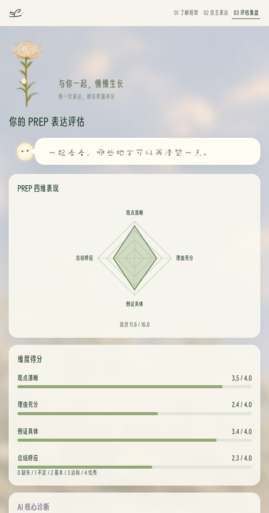
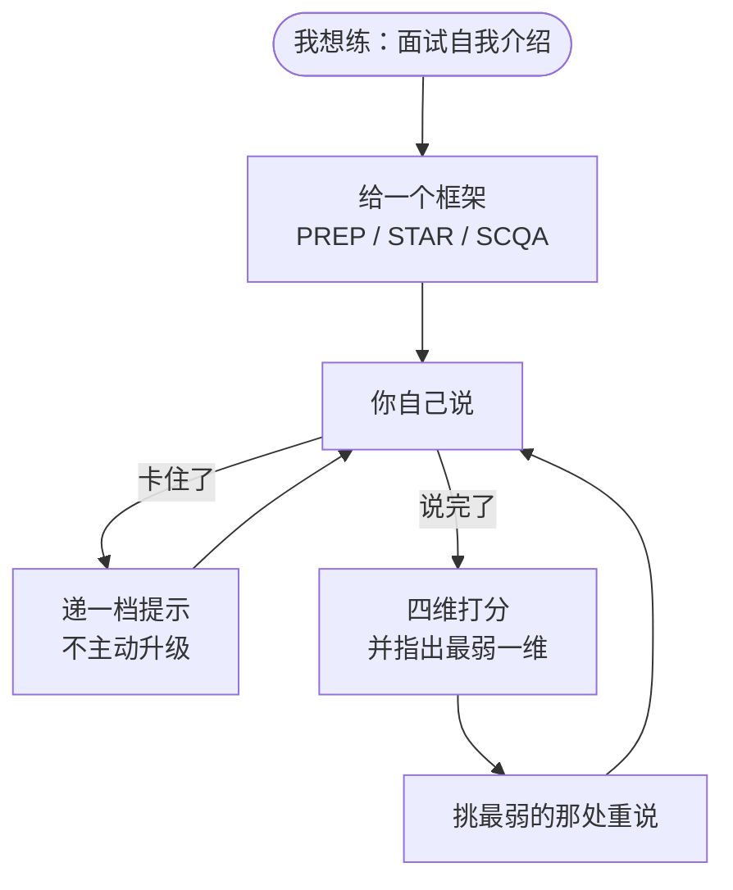

<div align="center">

# 表达陪练 · speaking-practice

**不替你写稿的陪练：卡住时只递一句话，说完告诉你差在哪。**

[](https://speaking-coach-62940.app.workbuddy.host/?sharecode=NXWD2KWPAQ)
[](#文件说明)
[](#文件说明)
[](#装在-ai-助手里)

<a href="https://speaking-coach-62940.app.workbuddy.host/?sharecode=NXWD2KWPAQ">
  
</a>

<sub><b>网页版 VoiceLab</b> —— 同一套架构做成的完整产品，点图直接体验</sub>

</div>

---

## 这是什么

一个装进 AI 助手里就能用的口语陪练。它**不写稿、不给答案**，只在你卡住的时候递一个词、一个问题、一个句式；说完之后按四个维度打分，挑最弱的一处让你重说。

做成 skill 而不是一个 App，是因为这套引导的价值全在**规则**里——什么时候给、给多少、给到第几档、什么话不能说。规则搬进任何支持 Skill 的客户端都能跑。

## 网页版：这套架构已经跑起来了

> **https://speaking-coach-62940.app.workbuddy.host/?sharecode=NXWD2KWPAQ**

网页版 VoiceLab 就是把这套规则做成可运行产品的样子——**同一个三档阶梯、同一个用户开关、同一套「有分必附原话」的四维评分**，另外加了实时语音转写、场景题卡和花园生长。

| 能力 | 这个 skill（对话里） | 网页版 VoiceLab |
|---|:---:|:---:|
| 三档提示 + 档位可见 | ✅ | ✅ |
| 用户开关（升级 / 降级 / 闭嘴） | ✅ | ✅ |
| 四维评分 + 原话引用 | ✅ | ✅ |
| 语音输入 | 宿主输入法语音键 | 实时流式转写（Qwen-ASR） |
| 题目从哪来 | 用户自己说 | 3 个场景 × 4 张题卡 |
| 进度感 | 文字 | 花园里的陪伴花随练习生长 |
| 需要装什么 | 一个文件夹 | 打开链接即可 |

<table>
<tr>
<td width="33%"><br><sub><b>① 给框架</b>：PREP 四格，只问不答</sub></td>
<td width="33%"><br><sub><b>② 卡住了</b>：一次只给一档，标出是第几档</sub></td>
<td width="33%"><br><sub><b>③ 说完了</b>：四维雷达 + 最弱一维</sub></td>
</tr>
</table>

## 一次练习长什么样



## 三档提示：它到底递什么

一次只给一档，而且**把档位写在脸上**，让用户知道一共有几档、现在第几档：

```
〔提示 1/3 · 关键词〕

摄影社 · 联系场地 · 二十多人
```

| 档 | 给什么 | 例子 | 上限 |
|---|---|---|---|
| **1/3**　关键词 | 两三个词，顺着说 | 「摄影社 · 联系场地 · 二十多人」 | 每项 10 字内 |
| **2/3**　一个问题 | 只问一件事 | 「你当时先找的谁？」 | 一个问题 |
| **3/3**　句式 | 带空位的句子，**必须留空** | 「那次【……】的时候，我负责的是【……】」 | 90 字内 |


**升级只能由用户触发。** 模型不会「顺便再说一点」，也不会自作主张往下推。用户换到别的格子时，会明说一句并把档位重置回 1/3。

第一次给提示时，它会用一句话交代这三档和切换方式，之后不再重复。

## 用户说什么，它怎么反应

| 用户说 | 它做什么 |
|---|---|
| 「还是不知道」「再给一点」 | 升一档，**节点不变** |
| 「太细了」「给个词就行」 | 降一档，节点不变 |
| 「不用了」 | 闭嘴，继续听，不再塞提示 |
| 「直接把稿子给我」 | 拒绝一次并说明理由，然后给 1/3 关键词 |
| 「这个说法对不对」 | 不启动这套流程，直接回答 |

## 评分：四个维度，有分必附原话

| 维度 | 看什么 |
|---|---|
| 观点清晰 | 有没有一句能单独拿出来当结论的话，立场是否前后一致 |
| 理由充分 | 理由是否支撑观点，而不是同义反复 |
| 例证具体 | 例子有没有时间、动作、数量这类可核验的细节 |
| 总结呼应 | 结尾是否回到开头的观点，还是停在例子上 |

每维 0–4 分，总分 16。硬规则是：**任何大于 0 的分数，都必须附一句能在转写里逐字检索到的原话**——对不上就不给分。这条是为了让「1.8 分」永远有据可查，而不是模型编出来的一个数字。

## 装在 AI 助手里

**支持 Skill 的客户端**（WorkBuddy / Claude Code 等）：把整个 `speaking-practice` 文件夹放进 skills 目录，例如
`~/.workbuddy/skills/`，下次会话自动可用。

**不支持 Skill 的客户端**（网页版 ChatGPT、Kimi、豆包等）：把 `SKILL.md` 粘进「自定义指令」或项目说明。
`reference/` 的四份不必全粘，需要时再贴对应那份。

**不需要 API key、不需要部署、不需要麦克风。** 用宿主自己的模型和输入法就行，打字发它也能练。

## 文件说明

| 文件 | 什么时候用到 |
|---|---|
| `SKILL.md` | 主流程与七条硬规则，必读 |
| `reference/ladder.md` | 三档的句式、字数上限、禁止项、升降规则 |
| `reference/frameworks.md` | PREP / STAR / SCQA 各自的四步 |
| `reference/rubric.md` | 四维怎么打分、引用怎么核 |
| `reference/tone.md` | 语气与长度 |
| `scripts/practice_state.py` | 记住「已经给到哪一档」，跨轮不忘 |
| `scripts/lint.py` | 自检：提示给多了没有、分数有没有瞎编 |
| `examples/walkthrough.md` | 一次真实练习的完整记录 |

脚本只用标准库，Python 3.8 以上能跑。**没有 Python 也不影响使用**——`SKILL.md` 里写了退化成对话内状态的做法。

```bash
# 拿一句「L3 却给整段」的违规提示试试，它会被拦下
python scripts/lint.py hint --level L3 \
  --text "〔提示 3/3 · 句式〕我觉得应该提前准备，因为上次活动就是没准备才乱成一团的"
# → FAIL  H4   L3 必须留空位（…… 或 【…】），否则就是代写
```

## 三句话上手

```
我想练一下面试自我介绍
我卡住了，不知道说什么
再来一次，我重说
```

## 一条边界

它拦得住「给整段」这类错，但拦不住你自己要答案。你说「直接把稿子给我」，它会拒绝一次，然后给关键词。
**这句拒绝是设计的一部分**，不是它不配合——对话里没有技术手段强制，只能靠规则和这句话，所以不要假装拦得住。
